<p align="center">
  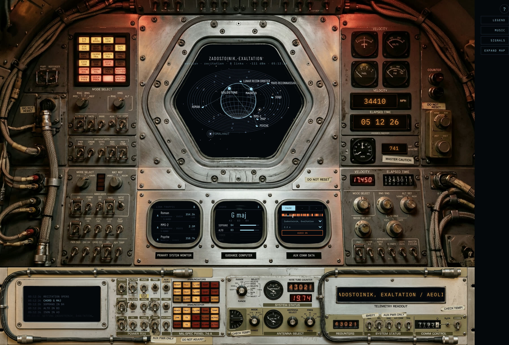
</p>

<h1 align="center">Far Voices</h1>

<p align="center">
  <em>NASA's Deep Space Network, sung as an Orthodox choir.</em><br>
  Every voice you hear is a real radio link to a real spacecraft.
</p>

<p align="center">
  <a href="https://farvoices.com">farvoices.com</a> ·
  <a href="https://farvoices.com/manual.html">flight manual</a>
</p>

---

## What this is

Three enormous antenna complexes, spaced roughly 120 degrees apart around the
Earth, spend every hour of every day listening to spacecraft. When one rotates
out of view, another picks up the conversation. NASA publishes what they are
doing as a small file that rewrites itself every five seconds.

Far Voices reads that file and sings it. Each active radio link becomes a voice
in a six part choir. How fast a spacecraft is sending data decides which voice
it gets. How faintly its signal arrives decides how loudly that voice sings.
The three seventy metre dishes, the biggest ears on the planet, bring in the
octavist, the Russian bass who sings an octave below everyone else.

The harmony is not invented. Every chord comes from two Russian Orthodox choral
collections published in 1892 and 1910, transcribed from scans page by page.

Nothing about the result is decorative. If you hear the choir thin out to two
voices, it is because the sky went quiet.

---

## Contents

1. [What you are looking at](#what-you-are-looking-at)
2. [The toy, console by console](#the-toy-console-by-console)
3. [The space half](#the-space-half)
4. [The music half](#the-music-half)
5. [How a signal becomes a voice](#how-a-signal-becomes-a-voice)
6. [How this was built](#how-this-was-built)
7. [Measured, derived, or assumed](#measured-derived-or-assumed)
8. [Running it](#running-it)
9. [Privacy](#privacy)
10. [Limits](#limits)
11. [Sources and licences](#sources-and-licences)

---

## What you are looking at

The interface is a 1960s spacecraft console. That is a deliberate choice rather
than nostalgia: the era when spacecraft were flown by people reading dials is
the era the Deep Space Network was built in, and the vocabulary still in use by
its operators (acquisition of signal, loss of signal, master caution) belongs to
those panels.

**The window.** A globe on real sidereal rotation, with the day and night sides
shaded from the actual sub solar longitude for the moment being played. The
three ground complexes sit at their true latitudes and longitudes, labelled
DAY or NIGHT. Arcs run from each dish out to whatever it is tracking. Behind all
of it, 2,068 real stars.

**Three terminals.** Link traffic on the left, the chord currently sounding in
the centre, transport on the right. The labels engraved on the panel came with
the artwork and turned out to fit: primary system monitor, guidance computer,
auxiliary comm data.

**The footer.** A logbook on the left recording discrete events as they happen,
and a ticker on the right describing continuous present state. The split is
deliberate. The logbook records what *happened*. The ticker describes what *is*.

**The painted controls work.** The annunciator block cycles the liturgical
setting. The toggle banks switch audio and transport. The mode knob steps the
playback rate. The nixie displays show real values: aggregate downlink in
kilobits per second, and UTC. Master caution lights on any acquisition or loss.

<p align="center">
  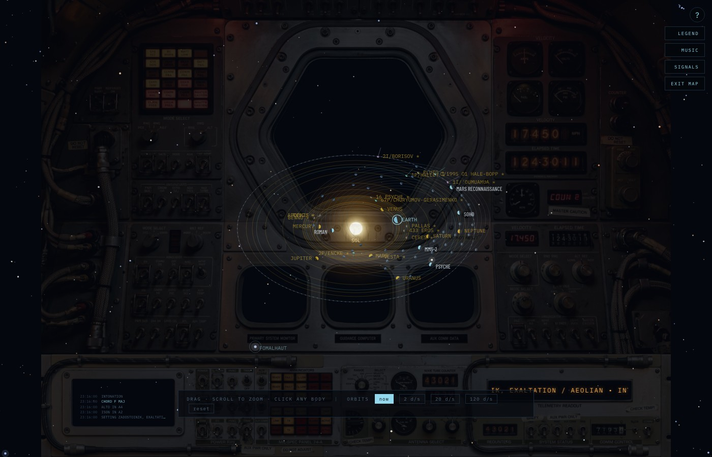
  <br><em>Expand map (F). The console fades back and the whole solar system appears.</em>
</p>

**The deck keeps going.** The main console is the top of a long page. Below it
are the panels a crew would have had within reach, each with live instruments
set into it, and they are all catalogued in
[the toy, console by console](#the-toy-console-by-console).

**The ship has systems, and they can go wrong.** None of this touches where
the music comes from, which stays real traffic throughout. But the deck around
it behaves like a vehicle. Lean on the hand controller with attitude hold off
and the ship starts turning, and it keeps turning until you stop it with the
stick and the thruster buttons, which spend propellant you do not get back.
Turn the cabin heat off and the temperature falls. Run the fan as well and
frost crawls in from the corners of the glass. Overload the electrical bus and
the deck browns out. Faults light lamps on the caution and warning panel and
climb if they are ignored: a caution, then a warning, then a master alarm with
a klaxon. Silencing the alarm does not clear the fault.

**The flight manual.** The question mark on the deck opens
[a manual](https://farvoices.com/manual.html) that explains every console, what
the alarms mean and how to stop a tumble. The two sections that would give the
game away are folded shut.

**When the network is quiet.** Sometimes every dish is between passes or down
for maintenance. Then nothing is being heard and the choir is silent, because
that is the truth. Over two months of logging it was the case about 3% of the
time. The deck says so when it happens and offers a recorded hour from the
archive instead.

**On a phone** it is the same console. It opens framed on the window, with
enough bezel either side to read as a window, and the rest of the deck is there
to pan across in both directions. An earlier phone layout, a chest-mounted unit
on a suit, is still in the repository as `ui/deck_mobile.html` and is no longer
served by default.

---

## The toy, console by console

Most of the switches work. There is nothing to win. Scroll the deck and you
meet about a dozen consoles, each a photograph with live instruments punched
through it. The real ones got a line of history, checked against the sources in
[COMPENDIUM.md](COMPENDIUM.md). The invented ones say so, because a made up
history is worse than none.

### 1. Guidance and flight director

<p align="center">
  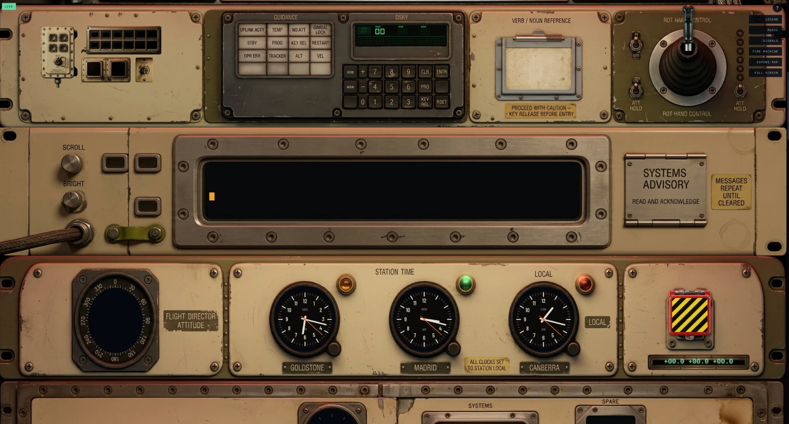
</p>

| Item | A line of history | Touch it |
|---|---|---|
| Keypad | MIT's Instrumentation Laboratory was given Apollo's guidance in August 1961, and the astronauts talked to its computer in two digit verbs and nouns. | Type a verb, then a noun. |
| Hand controller | Each Apollo command module couch had a rotational hand controller, wired in parallel so the two backed each other up. | Push it and the ship turns. Let go and it keeps turning. |
| Caution lamps and master alarm | Apollo 11's descent set off four 1202 alarms and one 1201, and Mission Control, having rehearsed a 1201 eleven days before launch, let the landing continue. | Faults light lamps and climb if ignored. The alarm button silences the noise and fixes nothing. |
| Advisory screen | Invented here. | It prints what whatever you touched is, and during an alarm, what to do. |
| Attitude ball | Apollo's was nicknamed the 8-ball: pitch and yaw read off the ball, roll off a pointer around its edge. | A green cross shows which way to push. |
| Station clocks | NASA's Deep Space Network was formally founded in 1963, when JPL's ground stations were tied into one network control centre. | Drag a knob sideways and time itself winds. |
| Abort switch | Invented here. | Lift the guard. |

### 2. The main console and the tape deck

<p align="center">
  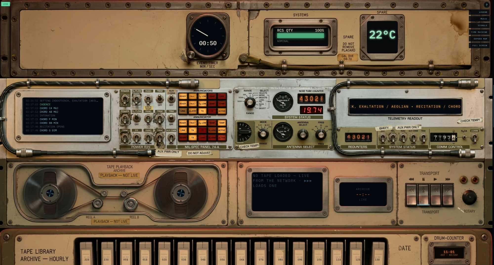
</p>

| Item | A line of history | Touch it |
|---|---|---|
| Event timer | Apollo carried an interval timer that worked like a kitchen timer and rang a bell. This one counts the seconds since the last thing that happened. | Read it. |
| Propellant and cabin thermometer | Invented here. | They become urgent when you misbehave. |
| Nixie counters | Burroughs introduced the Nixie tube in 1955, and who actually invented it is still argued. | They show real aggregate downlink and UTC. |
| Teleprinter and telemetry readout | Invented here. | Every chord and cadence prints as it sounds. |
| Annunciators and toggles | Invented here. | The annunciators cycle the liturgical setting, the toggles switch audio and transport, the knob steps the playback rate. |
| Tape transport | Don Leslie started on his rotating speaker in the late 1930s, Hammond turned it down, and he built it himself. The rotary knob is a Leslie. | Rewind, play, fast forward, turn the knob. |
| Tape library | Invented here. One reel per hour of sky. | Pull a spine, page days, pull the retaining bar, regret it. |

### 3. Score recorder, card reader and cabin

<p align="center">
  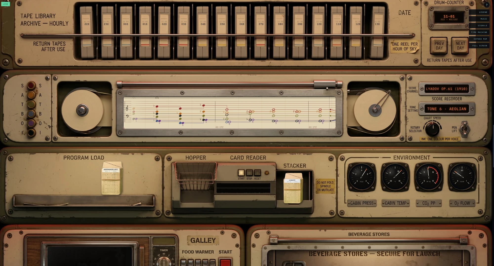
</p>

| Item | A line of history | Touch it |
|---|---|---|
| Score recorder | Its chords come from Lyadov's Op. 61 of 1910 and Arkhangelsky's Singing of Church Services of 1892. | Change the chart speed, lift the pen. |
| Card reader | IBM's 80 column card appeared in 1928, a redesign of the cards Hollerith built for the 1890 US census. | Feed it the other choir book and the choir sings from that one. |
| Cabin gauges | Invented here. | The thermometer is the one that matters. |
| Date drum | Invented here. | Previous day, next day. |

### 4. Galley, navigation, archive and communications

<p align="center">
  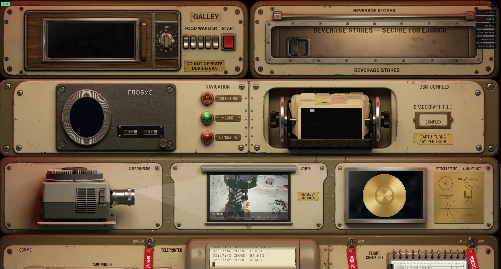
</p>

| Item | A line of history | Touch it |
|---|---|---|
| Galley | Skylab's food tray was the first device to heat food in spaceflight, by conduction. The microwave is ours. | Open it and run it. It draws on the same bus as everything else. |
| Beverage stores | Invented here. | Open the cabinet. |
| Globus | Soviet crews navigated with an electromechanical globe from Vostok through Soyuz, until about 2002. | Turn it. Its lamps glow while each complex has a spacecraft. |
| Card file | The rotary card file was patented in January 1956 by Hildaur Neilsen, an engineer at Arnold Neustadter's firm, and who deserves the credit is still argued. | Page through the fleet. |
| Slide projector | Kodak's Carousel went on sale in 1961 and the line ran until 2004. | Forwards, back. |
| Golden Record | Voyager's record plays at 16⅔ rpm, half an LP, and its cover carries diagrams on how to play it. | Spin it. |
| Teleprinter and tape punch | Donald Murray's 1901 system punched a tape first and sent from the tape, the idea behind punches like this. | Type a spacecraft's name and press Enter. The projector, card file and lamp all answer. |
| Remove Before Flight flags | Ground crews tie them to pins and covers that must come off before flight. Where the custom began we could not establish. | Pull all three. |
| ARM switches | Invented here. | Raise them. |

### 5. Crew station and the lower porthole

<p align="center">
  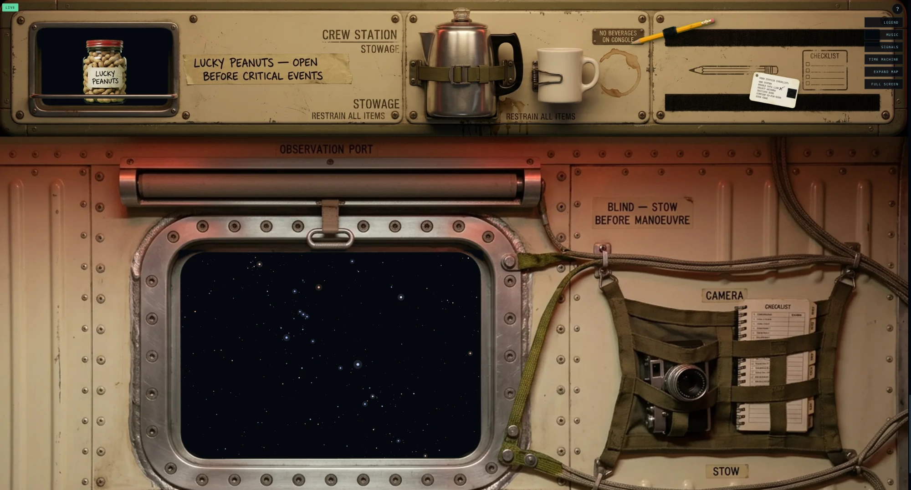
</p>

| Item | A line of history | Touch it |
|---|---|---|
| Peanut jar | JPL has passed peanuts around before critical events since Ranger 7 in 1964, which followed six failed Ranger missions. | It opens itself when a dish locks onto a spacecraft. |
| Pencil and card | NASA ordered mechanical pencils for Gemini in 1965. Fisher's pen did not fly until Apollo 7 in 1968. | Take them. |
| Percolator and mug | Invented here, under a plate that says no beverages on console. | Brew a coffee. It is a load on the bus. |
| Velcro | Patented in 1955 and adopted for Apollo, where Mike Collins reported stray hooks floating into his eyes. | Disturb whatever it holds down. |
| Porthole | A corned beef sandwich flew on Gemini 3 in March 1965, bought by Wally Schirra and smuggled aboard by John Young, and a congressional committee looked into it. | Wait for something to drift past, then take its picture. |

---

## The space half

### The Deep Space Network

The DSN is the communications system for everything humanity has sent beyond
Earth orbit. It has three complexes:

| Complex | Location | Dishes |
|---|---|---|
| Goldstone | Mojave Desert, California | DSS 14 (70 m) plus four 34 m |
| Madrid | Robledo de Chavela, Spain | DSS 63 (70 m) plus five 34 m |
| Canberra | Tidbinbilla, Australia | DSS 43 (70 m) plus three 34 m |

The spacing means at least one complex can see any deep space target at any
time. As the Earth turns, a spacecraft is handed from one to the next. That
handover is audible in the piece as a change in the stereo field, because each
complex is panned to its own position.

### The feed

`eyes.nasa.gov/dsn/data/dsn.xml` is the file behind NASA's public DSN Now
display. Measured behaviour, not documentation:

- Rewrites every **five seconds** (six consecutive samples, `Last-Modified`
  advancing 02:27:16 through 02:27:50)
- Serves `Access-Control-Allow-Origin: *`, so a browser can read it directly
- Sends `Cache-Control: max-age=3600`, so a cache busting parameter is required
  or you poll a frozen file for an hour

Each dish reports its azimuth, elevation, and local wind speed. Each active
signal reports direction, frequency band, data rate, and received power.

### What the numbers mean

**Data rate** spans eight orders of magnitude, from a few tens of bits per
second to over 100 megabits. A rover on Mars and a telescope at L2 are not in
the same league, and the piece uses that gap directly.

**Received power** is quoted in dBm, decibels relative to one milliwatt. Values
run from about −90 for a strong nearby craft to −150 for a faint distant one.
Because the scale is logarithmic, −150 is not slightly weaker than −90. It is
about a millionth as strong.

**Band** is the radio frequency in use. S band carries less data but is
forgiving of imprecise pointing. X band is the workhorse. Ka band carries the
most and demands the tightest aim.

### Round trip light time

The feed publishes a field for it. In every snapshot taken during development it
read −1, unpopulated. So the piece never uses it as a musical parameter, which
is the honest choice, and it appears only where you click a spacecraft and ask.

Light time is the one quantity that makes the distances real. A question asked
of Psyche is answered forty three minutes later. Voyager 1 is a light day away,
a line it crosses on 18 November 2026, which is why it appears on the map but
is deliberately excluded from the choir. Letting a craft downlinking at a few
tens of bits per second drive a voice would say more about its link budget than
about the sky. The antenna is another matter. A seventy metre dish tracking
Voyager genuinely is tracking, so it still brings in the octavist.

### The star field

2,068 stars from the Yale Bright Star Catalog, every one brighter than
magnitude 5.2, positioned by right ascension and declination, sized by
brightness and tinted by colour temperature. The catalogue was checked before
it was trusted: Sirius resolves to −1.46, Canopus to −0.72, Arcturus to −0.04,
Vega to 0.03. Twenty five stars carry names, distances and spectral types, and
clicking one tells you what year the light you are seeing left it.

### The solar system

Planetary positions come from the JPL approximate elements set, epoch J2000 with
per century rates, solved through Kepler's equation by Newton iteration: mean
anomaly to eccentric anomaly to true anomaly, then heliocentric ecliptic
longitude. The result was validated independently. On 2 September 2026 Earth
computes to a heliocentric longitude of 339.8 degrees, which is exactly 180
degrees from the Sun's geocentric longitude in early September, as it must be.

Asteroids and comets use mean elements only, without a proper epoch fit. They
are marked with an asterisk on the map and labelled approximate in their detail
panel, because they are.

Radial distance on the map is logarithmically compressed while angles stay
exact. Without that, Neptune sits thirty times further out than Mars and
everything inside Jupiter collapses into the Sun.

---

## The music half

<p align="center">
  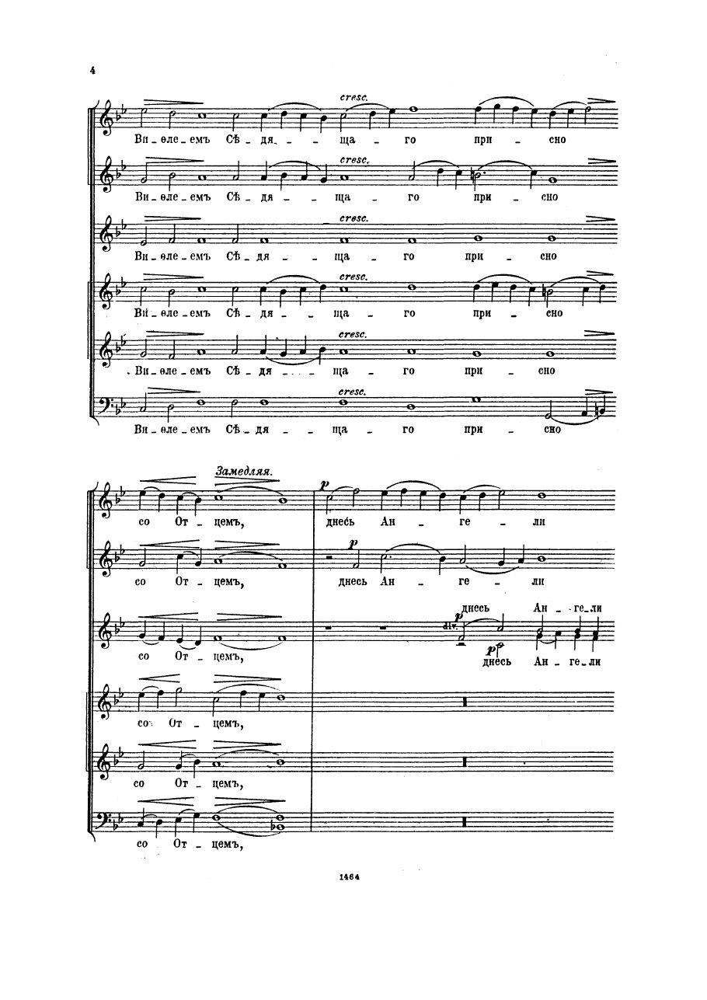
  <br><em>Lyadov, Op. 61 No. 1, a Nativity sticheron for six voices. Every chord
  in one of the two corpora was read from pages like this one.</em>
</p>

### Obikhod

The Obikhod is the common chant book of the Russian Orthodox Church, the
everyday repertoire rather than the concert repertoire. Its melodies are old,
mostly anonymous, and were sung in unison for centuries before anyone harmonised
them. In the nineteenth century composers began setting them for four part
choir, and that is the material this project uses.

Chant has a rigid skeleton that Western art music does not:

1. **Intonation.** A short opening formula that establishes the mode.
2. **Reciting tone.** A single pitch repeated once per syllable of text, for as
   long as the text requires. A verse of five words and a verse of twenty use
   the same music, stretched.
3. **Cadence.** A closing formula.

That structure is the reason this project works at all. A reciting tone that
stretches to fit its text is a musical form with a variable length slot in it,
and telemetry can fill that slot.

### The ison

Underneath the melody sits a sustained drone called the ison. It is not
accompaniment in the harmonic sense. It is a fixed point that the melody moves
around, and it is the oldest layer of the tradition.

In Far Voices the ison holds as long as anything at all is on the air. It is the
sound of the network being awake.

### The two corpora

Both are public domain, both were transcribed from scans, and they are kept
**separate rather than pooled**.

| | Lyadov, Op. 61 | Arkhangelsky, vol. 1 |
|---|---|---|
| Published | 1910 | 1892 |
| Content | Ten festal settings | Services for Great Lent |
| Pages | 22 | 58 |
| Chords extracted | 941 | 6,231 |
| Distinct harmonic moves | 73 | 89 |
| Moves seen only once | 21% | 10% |
| Traffic through dead ends | 1.8% | 0.3% |

The comparison is more interesting than either corpus alone. **Six and a half
times the data bought only 22% more distinct harmonic moves.** The vocabulary of
this idiom is genuinely small and close to saturated. What the larger corpus did
buy is reliability: transitions resting on a single observation halved, and
traffic through contexts with only one possible continuation dropped sixfold.

Pooling them measurably made things worse, adding sparse contexts rather than
filling them, which is why the interface lets you switch between them instead of
blending. They are eighteen years and one generation apart, and they do not
sound the same.

### How the chords are chosen

Chords are encoded as **root interval and quality**, never as roman numerals.
Roman numeral analysis assumes functional tonality, and applying it here
produces nonsense: it tries to correct an Aeolian minor v into a dominant, and
respells a Phrygian flat II as a Neapolitan. Neither is what the music is doing.

The chord model is a Markov chain over observed transitions. Telemetry reweights
the distribution but is **masked to the corpus support**, meaning it can only
reorder transitions that the composer actually wrote and can never introduce
one he did not. A temperature parameter controls how hard the sky pushes. At
zero it reproduces the source distribution to within a percentage point, which
is the regression test for the whole pipeline.

<p align="center">
  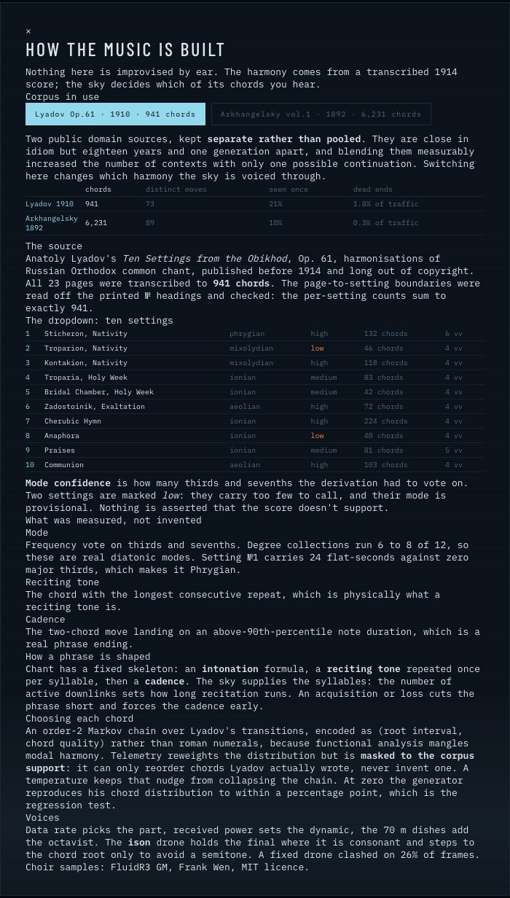
</p>

### The eight tones, and why they are not here

Orthodox liturgy runs on an eight week cycle called the Octoechos, each week in
a different mode. The original plan was to drive the piece from that cycle.

Lyadov's Op. 61 turned out not to contain it. The ten settings are festal
pieces for the Nativity, Holy Week, the Exaltation and the Liturgy, with no tone
labels anywhere. So the rotation runs through his ten real settings instead,
which is honest, rather than through eight tones that would have been invented
and presented as tradition.

### What was derived from the score

For each setting, measured rather than chosen:

- **Mode**, by frequency vote on thirds and sevenths. Degree collections run six
  to eight of twelve, so these are real diatonic modes and not noise. Setting
  No. 1 carries twenty four flat seconds against zero major thirds, which makes
  it genuinely Phrygian.
- **Mode confidence**, reported honestly. Two settings are marked low because
  the vote had too few thirds and sevenths to be sure. Their modes are
  provisional and the interface says so.
- **Reciting tone**, taken as the chord with the longest consecutive repeat,
  which is physically what a reciting tone is.
- **Cadence**, taken as the two chord move landing on a note in the top decile
  of durations, which is what a phrase ending looks like in the data.

---

## How a signal becomes a voice

| Musical parameter | Driven by |
|---|---|
| Which voice part | Data rate, log scaled |
| Loudness | Received power in dBm, as a continuous expression ramp |
| Vowel | Frequency band. S sings *oo*, X and Ka sing *ah* |
| Stereo position | Which complex holds the link |
| Octavist enters | A seventy metre dish is tracking |
| Ison holds | Anything at all is on the air |
| Phrase length | Number of active downlinks, one per syllable |
| Cadence fires early | A spacecraft acquires signal, loses signal, or opens or closes a second simultaneous downlink |
| Two voices at once | A spacecraft running two simultaneous downlinks &mdash; each is scored independently by its own rate |

Voice assignment by data rate, with the measured distribution of every link
recorded:

| Rate | Voice | Share of links |
|---|---|---|
| under 40 kb/s | Bass | 24% |
| 40 kb/s to 250 kb/s | Tenor | 26% |
| 250 kb/s to 800 kb/s | Alto | 26% |
| over 800 kb/s | Soprano | 24% |

Across the recorded material the choir averages **five voices of six sounding**,
with all six present in 42% of frames.

Loudness uses a continuous expression controller rather than note velocity. This
matters more than it sounds. Sampled choirs switch between recorded velocity
layers, so driving loudness with velocity produces abrupt changes of vowel and
intensity where a swell was wanted. An expression ramp glides.

Occasionally a spacecraft runs two downlinks at once &mdash; a parallel science
and housekeeping stream, or two distinct bands. Verified directly against the
live feed rather than assumed: Wind was seen holding two simultaneous S band
carriers through Madrid, and James Webb a K band science downlink alongside a
separate S band one, both real and both active at once. Each carrier is scored
independently by its own rate, so the two can land in different voice parts
simultaneously, with neither aware the other exists. Opening or closing either
one is treated exactly like an acquisition or loss: the phrase cuts short. It
is rare enough across the recorded material to be worth marking as its own
event rather than folding silently into whichever two parts the rates happen
to land in.

<p align="center">
  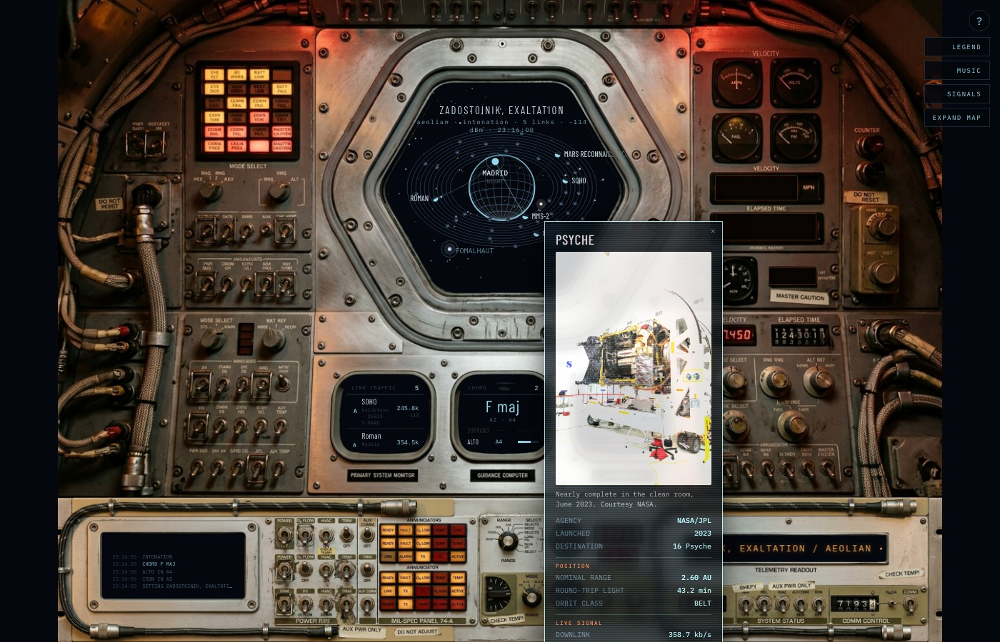
  <br><em>Every ground station has a real photo. A growing number of
  spacecraft do too &mdash; here, Psyche nearly complete in the clean room.
  The rest of the dossier keeps updating live while the panel is open.</em>
</p>

---

## How this was built

The starting question was narrow: which NASA data source is both live and
interesting enough to carry music. Most are not live. Space weather notification
feeds publish discrete events and are silent for hours. Astronomy picture of the
day changes daily. The DSN feed was chosen because a five second refresh was
confirmed by measurement before anything was built on top of it.

The first design was an organ. Data rate would map to pitch across three
octaves, band to timbre, and signal strength to volume. It would have worked and
it would have been forgettable. The shift to a choir changed the constraints in
a productive way, because sampled voices cannot do continuous pitch. They are
quantised to semitones and they need time to speak. That forced the question of
what harmony they should sing, and that question led to the Obikhod.

The assumption that Lyadov's Op. 61 contained the eight tones was wrong, and
finding out required reading the title page. The book is ten festal settings.
The eight tone rotation had to be abandoned or invented, and inventing it and
calling it traditional was not an option, so the rotation now runs the ten real
settings.

Several things were wrong for a long time before measurement caught them.

The ison was pinned to the final of the mode while the chord model wandered
freely through the corpus. Measured across the material, **26% of frames
contained a semitone clash**, almost always between the drone and a sounding
voice. A minor ninth against a drone is not an Obikhod sound, it is a mistake.
The ison now holds the final wherever it is consonant and steps to the chord
root only to avoid a semitone, which is faithful to a tradition where the ison
does move between structural degrees. Clashes went to zero.

The Markov model claimed to be order 2 and was not. The transition table was
keyed on a pair of chord qualities whose values were moves that produced the
second of them, so a lookup could only ever return the quality it already had.
The chain locked on its first chord and never left. Rebuilding the tables from
the raw per piece sequences fixed it, and the regression test is that at zero
telemetry weight the generator now reproduces the source distribution.

The map was geocentric, and not for any defensible reason. Earth's globe sat at
the centre of frame with every planet hung off it on angles derived from array
index, a placeholder that was never replaced and not a model of anything. That is
a picture of the solar system that has been wrong since 1543. Fixing it meant
real Kepler-solved orbital elements and the Sun at the centre, Earth one body
among the rest.

That fix surfaced a second problem the broken version had been accidentally
hiding: no single view can serve both interplanetary distances and Earth's own
satellites. Zoomed in far enough to tell low orbit from geostationary from
lunar distance, the rest of the solar system says nothing useful. Zoomed out
far enough to show Neptune, Earth's entire tracked fleet collapses to one
indistinguishable point. The map now switches between two projections built on
the same Kepler solver rather than picking a winner: heliocentric, Sun at
centre, for the planets; Earth-focus, Earth at centre, for its own spacecraft
and Moon at a scale meant to actually be read. Neither is the approximate one.
They answer different questions, and the switch was identical on the desktop
console and on the phone layout of the time, a suit-mounted unit since retired
in favour of the console itself.

<p align="center">
  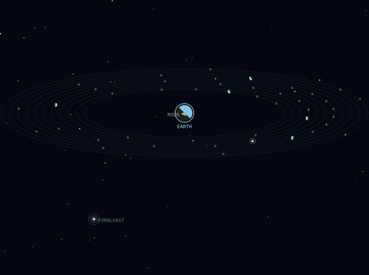
  <br><em>Earth-focus on mobile. Same Kepler solver, same live telemetry, a
  different centre and a different scale.</em>
</p>

Real hardware caught what desktop testing couldn't, which is a polite way of
saying I shipped it and a phone disagreed. iOS ties its audio unlock to the
exact gesture that starts it, and this deck waits on a live-feed connection
that can take fifteen seconds. Resume the `AudioContext` after that wait and it
reports "running", Safari's tab indicator agrees, and nothing comes out.
Developer tools cannot tell that state from working. It was found because
someone was holding an actual phone, the one debugging tool I had not already
tried. A second bug from the same stretch got the same treatment: the
previous and next acquisition controls read from a snapshot of frame positions
that live mode quietly swapped out underneath them, so tapping either one
mid-session threw inside the render loop and froze every canvas-drawn element
for good, with nothing printed anywhere to say why. Both sailed through
headless testing, and both were my own regressions from the live-feed work, not
the original build's. The original build was, in fairness, fine.

The console is neither drawn in code nor photographed. Each panel is a
generated image with its live areas painted flat black. A small tool finds
those rectangles, punches them transparent and writes down where they are, and
every gauge, screen and switch is drawn at those measured coordinates. The
first attempt at adding instruments placed them by eye and put gauges on top of
the console's own painted hardware. They are now placed only where the panel
was measured to be empty.

Logging every request seemed free and was not. Routing each image and script
through the Worker so it could be counted turned one page view into sixty nine
billable requests. Only documents and endpoints pass through the Worker now, and
a page view costs three.

The most useful bug report was a correct one. On a phone the choir would not
start, and every diagnostic said the audio was healthy: context running, thirty
six samples decoded, nothing singing. NASA's feed, read directly, showed all
fifteen dishes on engineering work and no spacecraft in contact. The site was
faithfully playing silence, which to a visitor is indistinguishable from a
broken page. It now admits the sky is empty and offers a recorded hour instead.

The second corpus was added to test whether corpus size was the bottleneck. The
measurement said mostly not, and pointed somewhere else: the reciting tone
repeats a single chord for up to nine syllables, so recitation frames dominate
the output and the harmonic variety is largely inaudible. Both corpora produce
output that is over 75% major against sources that are 41% and 52% major. The
next real improvement is musical form, not more sources.

---

## Measured, derived, or assumed

Everything on screen falls into one of three categories, and the project tries
to be explicit about which.

**Measured.** Star positions and magnitudes. Planetary positions. All telemetry:
data rates, received power, bands, dish assignments, acquisitions and losses.
Chord transition statistics. The five second feed cadence.

**Derived.** Modes, reciting tones and cadences for each setting, computed from
the transcribed chords by the rules described above, with confidence reported.
Voice assignment thresholds. Asteroid and comet positions, which use mean
elements and are labelled approximate.

**Assumed.** The mapping itself. That data rate should choose voice part rather
than pitch, that received power should control loudness, that a seventy metre
dish should summon the octavist. These are design decisions. They are defensible
and they are not discoveries.

---

## Running it

```bash
python3 -m venv .venv
./.venv/bin/pip install -r requirements.txt
```

**Record the sky.** The DSN feed publishes only the present moment and keeps no
history, so a recorder is the only way to get a past.

```bash
nohup ./.venv/bin/python -u record.py > record.log 2>&1 &
```

It writes one line per meaningful change rather than one per poll. The raw feed
rewrites every five seconds, so logging every poll would cost roughly 115 MB a
day to record timestamps moving while the sky stands still.

**Sing it.** Into any MIDI destination, six channels, one per voice.

```bash
./.venv/bin/python farvoices.py --port "IAC Driver Bus 1" --corpus obikhod_corpus.json
./.venv/bin/python farvoices.py --render --smf out.mid --minutes 6
```

**Build a corpus** from scans, once optical music recognition has produced
MusicXML.

```bash
./.venv/bin/python build_corpus.py --in scores/<name>/batches \
    --out <name>_corpus.json --source "<citation>"
```

**Open the deck.** The site is static files and one small Worker. To look at
the deck without the Worker:

```bash
python3 -m http.server 8788 --directory ui
```

Then open `http://localhost:8788/deck_cockpit.html`. Power Up looks for a
relay, finds none, and plays the recorded frames baked into the page.

---

## Privacy

No cookies, nothing stored on a visitor's device, and no account of any kind.
The site keeps basic server logs and some anonymous usage counts, and honours
Global Privacy Control and Do Not Track. The short version is on the
[privacy page](https://farvoices.com/privacy.html), and anything more can be
had by writing to the contact address there.

---

## Limits

Stated plainly, once.

**The corpora are optical music recognition output.** Individual chords contain
errors. The aggregate statistics are what the generator uses and they survive a
scattering of mistakes, but no one should quote a single chord from these files
as being what the composer wrote. Verify against the score.

**Two of the ten settings have low confidence modes.** Too few thirds and
sevenths to call. They are marked in the interface.

**Asteroid and comet positions are approximate.** Mean elements, no epoch fit.
Planets are accurate; the small bodies will drift from reality.

**No listening study has been run.** Nobody has tested whether a listener can
hear the difference between a busy sky and a quiet one, or between the two
corpora. The mapping is defensible on its own terms. Whether it communicates is
untested and is not claimed.

**The mapping is one of many.** Nothing about the physics requires that data
rate choose voice part. A different set of choices would produce different and
equally valid music.

**The choir is a soundfont.** The voices are General MIDI choir samples, not a
recording of anyone singing. It sounds like a choir pad and not like forty
people in a cathedral.

**The live feed depends on one publisher.** A single process reads NASA's feed
and relays it. If it stops, the site falls back to recorded frames of real
traffic and the LIVE badge goes away.

---

## Sources and licences

**Telemetry.** NASA Deep Space Network, via the public DSN Now feed. NASA
material is generally not subject to copyright.

**Stars.** Yale Bright Star Catalog, 5th revised edition.

**Planetary elements.** JPL approximate positions of the planets, valid roughly
1800 to 2050.

**Scores.** Anatoly Lyadov, *Ten Settings from the Obikhod*, Op. 61, published
before 1914. Alexander Arkhangelsky, *Singing of Church Services*, volume 1,
St Petersburg 1892. Both public domain, both scanned by the Sibley Music Library
and hosted by IMSLP. Extracted harmonic data are facts about public domain
compositions. The scans themselves are not redistributed here.

**Choir samples.** FluidR3 GM soundfont by Frank Wen, MIT licence, programs 52
and 53. Redistribution requires that the copyright notice travel with it, which
it does.

**Photographs.** Ground station and spacecraft dossier images are public
domain NASA/JPL-Caltech material via official NASA and JPL image releases,
free to use for any purpose with attribution and no implied endorsement, per
[NASA's image use policy](https://www.jpl.nasa.gov/jpl-image-use-policy). The
Lucy integration photo is credited to Lockheed Martin under the same release
terms. Each dossier and station panel carries its own specific credit line.

**Console histories.** Each one line history in the toy section is sourced in
[COMPENDIUM.md](COMPENDIUM.md), with the claims we left out and why.

**Console artwork.** Console artwork generated with Google Gemini; built with Anthropic's Claude. The site's footer says the same.

**Code.** See LICENSE.
